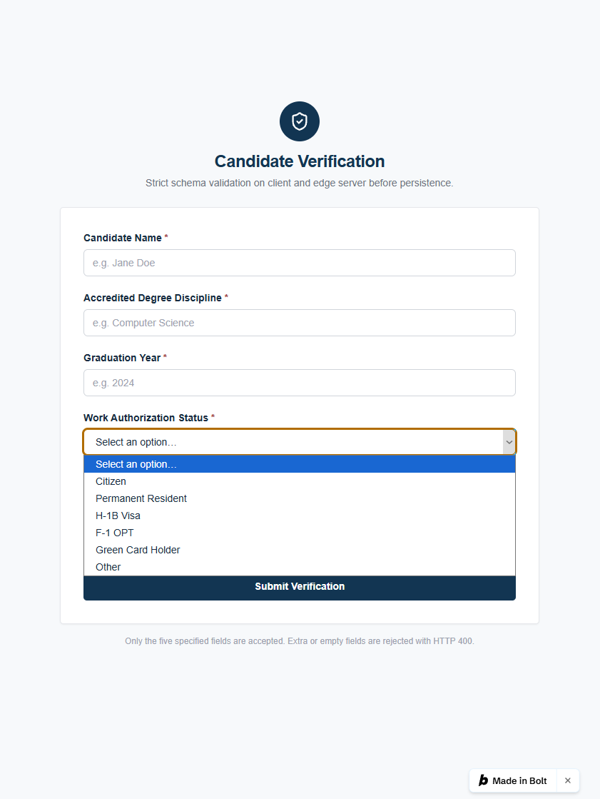
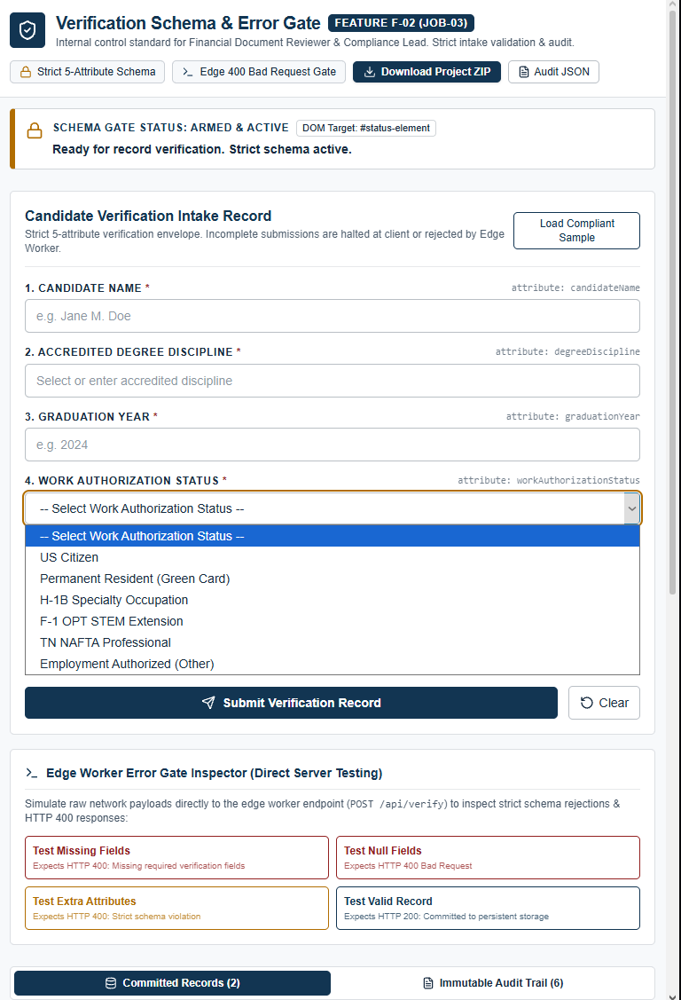

# HW6: Two Builders, One Specification

> Replace every line in angle brackets. A README that still carries template placeholders loses points.

## Feature

**Team repository:** [Team Beta Repo](https://github.com/Kcornett533/mgt3745-team-beta)
**Spec provenance:** copied from commit d3c4267fabcf4433c96778256640c3a07a5fd97b on 2026-10-22

**Feature:** <ID and name from your team's FEATURES.md>

### Feature F-02: Strict Verification Schema & Error Gate (Must-be)
*Traces to: USERS.md (JOB-03)*

- **Ubiquitous:** The system shall enforce complete schema validation on both client and edge server before committing any candidate verification record to persistent storage, restricting payload attributes strictly to candidate name, accredited degree discipline, graduation year, work authorization status, and coursework artifact URL.
- **Event-driven:** When an intake payload contains missing, null, or empty fields, the edge Worker shall reject the request with HTTP 400 Bad Request and return a descriptive JSON error (`{"error": "Missing required verification fields"}`).
- **State-driven:** While an error state is active, the client UI shall render the error message visibly in the status element using `textContent` and retain previously entered data in form fields.
- **Unwanted-behavior (IF):** If a user attempts to submit the form with any required compliance field empty, then the system shall halt network submission and display an inline warning identifying the missing field.

## See It Work

| bolt.new | AI Studio |
|---|---|
|  |  |

<Replace the two images above with your own screenshots, or one side-by-side GIF.>

## Status

<One or two sentences: how many EARS rows each builder satisfied, and your recommendation in one line.>

## How to Run the Evals

```bash
npm test
```

<Say what the test checks and what output to expect.>

## Links

- [EVALS.md](EVALS.md): Prediction Stake and error log
- [COMPARISON.md](COMPARISON.md): evidence, spec gaps, and recommendation
- [JUDGMENT.md](JUDGMENT.md): judgment eval and agreement rate
- [prompts/PROMPT.md](prompts/PROMPT.md): the exact input both builders received
- [builds/](builds/): bolt.zip and aistudio.zip
- [docs/DDR-001.md](docs/DDR-001.md) (bolt.new), [docs/DDR-002.md](docs/DDR-002.md) (AI Studio)
- Team pull request or issue: <URL>
- Deployed Worker (only if you completed the proxy step): <URL>

## Hours

<Total hours spent, with a one-line breakdown.>

## AI Use

<Every tool that wrote more than a line or two, each with a link to its DDR.>
